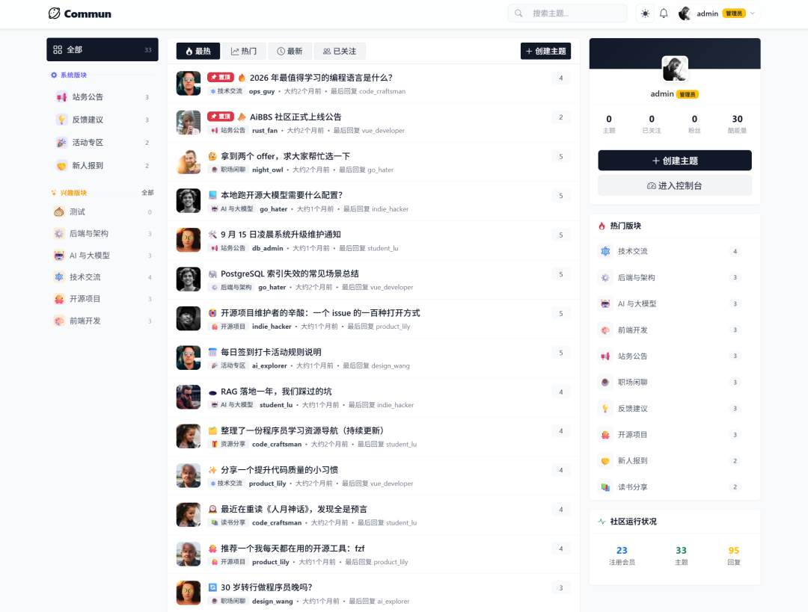

# ComMun 

ComMun 是一个插件化的开源社区系统，以基础社区为底座，通过插件和主题灵活扩展。提供社区核心功能、RESTful API、管理后台与插件/主题运行时。

官网：http://www.commun.cc

## 在线演示

- **演示站**：<https://commun.oxida.cn/>（可自由注册体验前台功能）
- **管理后台**：<https://commun.oxida.cn/admin>（不公开提供后台账号密码，如需体验请联系）

> 后台演示账号需单独获取，QQ 联系：**1665201057**

## 交流群

欢迎加入 ComMun 社区系统 QQ 交流群（扫码入群）：


## 功能特性

- **社区核心**：节点（版块）、话题、回复、评论互动、@提及、内容审核
- **用户体系**：注册登录（Devise）、OAuth 登录（GitHub / Gitee / Google）、用户主页、关注与拉黑
- **积分能量**：酷能量体系、内容付费解锁、VIP 专属内容
- **插件系统**：插件热插拔，`plugins/` 目录即装即用，支持视图注入与配置
- **主题系统**：CSS 变量驱动的多主题，支持亮/暗色自适应，后台上传 ZIP 安装
- **管理后台**：站点外观、节点管理、用户管理、运营账号、友链、主题/插件管理
- **开放 API**：`/api/v1` RESTful 接口 + JWT 鉴权（接口文档见 `docs/`）

## 页面截图


*社区首页（默认主题）*

## 技术栈

| 组件 | 版本/说明 |
|---|---|
| Ruby | 3.4.4 |
| Rails | 8.1 |
| 数据库 | PostgreSQL |
| 前端 | Bootstrap 5 + Hotwire (Turbo/Stimulus) + Propshaft |
| 认证 | Devise + OmniAuth + JWT |

## 快速开始

### 环境要求

- Ruby 3.4.4
- Node.js 20（前端构建）
- PostgreSQL 12+

### 本地开发

```bash
# 1. 安装依赖
bundle install
npm install        # 或 corepack enable && yarn install

# 2. 配置数据库（或使用环境变量 DB_HOST / DB_PORT / DB_USERNAME / DB_PASSWORD / DB_DATABASE）
bin/rails db:prepare

# 3. 构建前端资源并启动
npm run build
bin/rails server -b 0.0.0.0 -p 3000
```

访问 http://localhost:3000，管理后台入口：`/admin`。

### Docker 部署

```bash
docker build -t commun-server .
# 环境变量与部署细节见 DEPLOY.md 和 ENVIRONMENT_VARIABLES.md
```

## 插件系统

插件位于 `plugins/` 目录，每个插件包含 `plugin.json`（元信息）、`init.rb`（挂载逻辑）等，可在管理后台启用/禁用。

内置插件：

| 插件 | 说明 |
|---|---|
| `polls` | 话题投票 |
| `courses` | 课程 |
| `shop` | 积分商城 |
| `honors` | 荣誉勋章 |
| `chat_groups` | 聊天群组 |
| `question_banks` | 题库 |
| `invitation_codes` | 邀请码 |
| `kols` | KOL 运营 |
| `tools` | 工具集 |
| `oauth_github` / `oauth_gitee` / `oauth_google` | 第三方登录 |
| `example_hello_world` | 插件开发示例 |

开发自定义插件请参考 `plugins/example_hello_world/`。

## 主题系统

主题位于 `themes/` 目录，每个主题包含：

```
themes/<identifier>/
├── theme.json      # 名称、版本、预览色等元信息
├── styles.css      # 亮色主题（CSS 变量）
├── dark.css        # 暗色主题（可选，跟随系统）
└── screenshot.png  # 预览截图（1200x800）
```

- 启动时自动扫描 `themes/*/theme.json` 注册到数据库
- 管理后台可上传 ZIP 安装新主题、一键切换启用主题
- 内置主题：黑白极简（default）、宠物社区（pet_community）、森林绿（forest_green）、暮光暖橙（sunset_warm）、绯红（crimson_red）

主题生态与更多插件/主题可通过独立部署的 ComMun 插件&主题中心获取，站点管理后台配置中心地址与接入令牌后即可在线安装。

## 目录结构

```
commun-server/
├── app/            # MVC（controllers / models / views / helpers / jobs / services）
├── config/         # 路由、初始化、locales
├── db/             # 数据库迁移与种子数据
├── docs/           # API 文档（OpenAPI / Postman / 设计文档）
├── lib/            # 框架扩展（ThemeManager、PluginLoader 等）
├── plugins/        # 插件目录
├── public/         # 静态资源
├── themes/         # 主题目录
├── Dockerfile      # 生产镜像构建
├── DEPLOY.md       # 部署指南
└── ENVIRONMENT_VARIABLES.md  # 环境变量说明
```


## 文档

- [部署指南](DEPLOY.md)
- [环境变量](ENVIRONMENT_VARIABLES.md)
- [API 设计](docs/api_design.md) / [OpenAPI](docs/api_openapi.yaml) / [Postman](docs/api_postman.md)

## License

本项目基于仓库内 LICENSE 授权发布。
